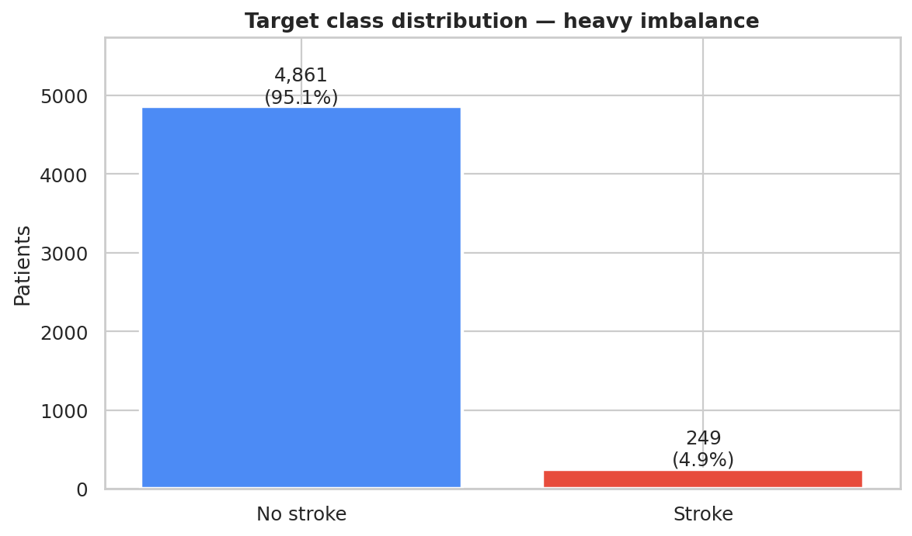
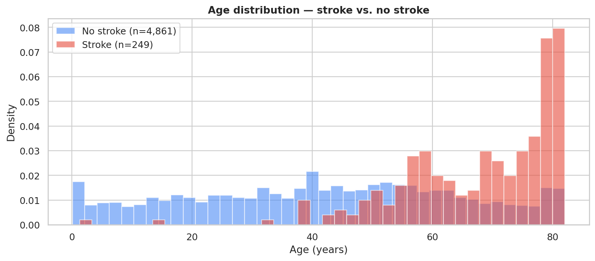
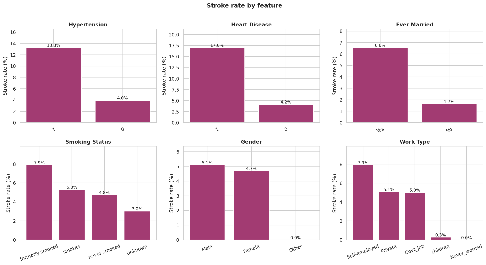
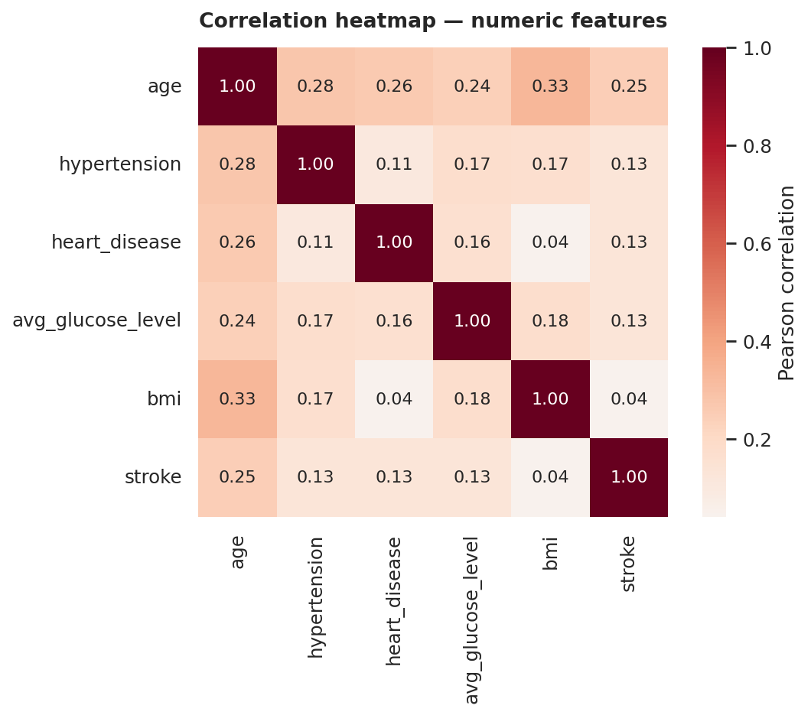

# Stroke Prediction — End-to-End ML Pipeline

> DEPI (Digital Egypt Pioneers Initiative) team capstone. Predicts stroke risk from clinical + lifestyle features on the Kaggle Stroke Prediction dataset (5,110 patients, 4.9% positive class). Full pipeline: data cleaning, EDA, feature engineering, imbalanced classification modeling, and a Flask REST API for predictions.


---

## 👥 Team

This is a **team project**. My contribution: **data cleaning & EDA** (`notebooks/eda.ipynb`).

| Contributor | GitHub | Role |
|---|---|---|
| Zeyad Elshenawy | [@ZeyadElshenawy](https://github.com/ZeyadElshenawy) | Data cleaning & EDA |
| Forge | [@forge34](https://github.com/forge34) | Preprocessing pipeline, modeling, API, visualization |
| Mahmoud Ebrahim | [@Mahmoudebrahim156](https://github.com/Mahmoudebrahim156) | Project setup |
| Mohamed Ashraf | [@MohamedAchraf22](https://github.com/MohamedAchraf22) | PR contributions |

**Original team repo:** [Mahmoudebrahim156/healthcare-prediction-depi](https://github.com/Mahmoudebrahim156/healthcare-prediction-depi). This is a polished mirror with expanded documentation and extracted EDA plots.

---

## 🎯 Key results

| Metric | No stroke (n=969) | Stroke (n=50) |
|---|---:|---:|
| Precision | 98.9% | 16.5% |
| Recall | 78.0% | **84.0%** |
| F1 | 87.3% | 27.5% |

**Model:** Logistic Regression (L1 regularization, C=0.3, `class_weight='balanced'`, saga solver). Decision threshold tuned to **0.6027** via precision–recall curve analysis.

**Why this is strong:** for stroke *screening*, recall (catching actual positives) matters far more than precision (avoiding false alarms). **84% recall** means the model catches 84 of every 100 stroke cases — an appropriate operating point for a triage tool that would route high-risk patients to further clinical assessment.

---

## 📊 Dataset

**Kaggle Stroke Prediction Dataset** (fedesoriano) — 5,110 patients × 12 features: `age`, `gender`, `hypertension`, `heart_disease`, `ever_married`, `work_type`, `Residence_type`, `avg_glucose_level`, `bmi`, `smoking_status`, `stroke`.

**Heavy class imbalance:** 4,861 no-stroke (95.1%) vs 249 stroke (4.9%). This shapes every downstream modeling decision — stratified splits, class weighting, threshold tuning, and recall as the headline metric.

---

## 🔍 EDA findings

> All plots below are regenerated from `datasets/raw/dataset.csv` — run `python generate_figures.py` to reproduce them.

### Class imbalance


Only **4.9%** of patients had a stroke. The model can achieve 95% accuracy by always predicting "no stroke" — which is why accuracy is the wrong metric here. We optimize for **recall on the minority class**.

### Age is the dominant risk factor


Stroke cases concentrate sharply in older ages (distribution peaks ~70) while no-stroke patients span the full age range. Age is the strongest single predictor in this dataset.

### Stroke rate by lifestyle / medical flags


Key observations:
- **Hypertension** and **heart disease** roughly **triple** the stroke rate
- **"formerly smoked"** shows a higher stroke rate than **"smokes"** — reflecting age correlation (people who formerly smoked skew older)
- Being married shows a higher stroke rate — again a proxy for age, not a causal factor

### Numeric correlations


Age dominates correlation with stroke (**0.25**), followed by heart disease and avg glucose. BMI shows **very weak linear correlation** with stroke — it matters only as part of a non-linear cardiovascular risk composite, which is why the feature-engineering step built an `age_bmi_interaction` term.

---

## 🧪 Methodology

1. **Clean** — fill missing `bmi` (201 rows) with group medians, drop implausible BMI values (<12 or >60), normalize `smoking_status` 'Unknown' category, remove the `id` column
2. **Feature engineer** — age-group bins (Young / Adult / Middle-Aged / Senior), BMI class (Underweight / Normal / Overweight / Obese), glucose risk (Normal / Prediabetes / Diabetes), `age × bmi` interaction, cardiovascular risk composite (hypertension + heart_disease + high-glucose)
3. **Encode** — one-hot for all categorical features → 26-column processed dataset
4. **Scale** — `StandardScaler` on numeric features (age, avg_glucose_level, bmi, age_bmi_interaction)
5. **Stratified split** — 80/20 train/test, stratified by `stroke` to preserve the 4.9% class ratio in both splits
6. **Model** — Logistic Regression with `class_weight='balanced'` + **L1 penalty** for automatic feature selection
7. **Threshold tuning** — precision-recall curve analysis chose **0.6027** as the operating point (highest recall at precision ≥ 15%)
8. **Serve** — Flask REST API (`src/app.py`) loading the pickled artifact (pipeline + model + threshold)

---

## 📂 Project structure

```
healthcare-prediction-depi/
├── notebooks/
│   ├── eda.ipynb                 # ← My contribution: cleaning + EDA (59 cells)
│   ├── model.ipynb               # Modeling experiments
│   ├── model-experimental.ipynb  # Model comparison
│   ├── mlflow.ipynb              # MLflow tracking
│   └── visualization.ipynb       # Visualization experiments
├── src/
│   ├── preprocessing.py          # Preprocessing transformer
│   ├── pipeline.py               # sklearn Pipeline definition
│   ├── model.py                  # Trains and saves the final pkl
│   ├── model_api.py              # Loads pkl, exposes predict()
│   ├── visualization.py          # Standalone visualization script
│   ├── app.py                    # Flask server
│   └── static/index.html         # Frontend
├── datasets/
│   ├── raw/dataset.csv           # Kaggle source
│   └── processed/dataset.csv     # Post feature-engineering (26 cols)
├── figures/                      # README plots (generated)
├── presentation/presentation1.pptx
├── stroke_model.pkl              # Trained artifact (pipeline + model + threshold)
├── generate_figures.py           # Regenerates figures/ from datasets/raw/
├── requirements.txt
├── environment.yml
├── LICENSE
└── README.md
```

---

## 🚀 How to run

### Install dependencies

```bash
pip install -r requirements.txt
```

or with conda:

```bash
conda env create -f environment.yml
conda activate healthcare-prediction-depi
```

### Explore the notebooks

```bash
jupyter notebook notebooks/eda.ipynb
```

The EDA notebook ships with outputs preserved so you can read it end-to-end without running any cell.

### Retrain the model

```bash
python src/model.py
# → produces stroke_model.pkl at repo root
```

### Serve predictions via the Flask API

```bash
cd src && python app.py
# POST JSON to http://localhost:5000/predict
```

Example payload:
```json
{
  "age": 67,
  "gender": "Male",
  "hypertension": 1,
  "heart_disease": 1,
  "ever_married": "Yes",
  "work_type": "Private",
  "Residence_type": "Urban",
  "avg_glucose_level": 228.69,
  "bmi": 36.6,
  "smoking_status": "formerly smoked"
}
```

Response:
```json
{
  "stroke_probability": 0.8143,
  "final_prediction": "High Risk - Stroke Likely",
  "model_decision": "Positive (Stroke)"
}
```

---

## 🛠️ Tech stack

Python · pandas · numpy · scikit-learn · matplotlib · seaborn · plotly · Flask · MLflow · Jupyter

## 📚 Dataset source

[Stroke Prediction Dataset](https://www.kaggle.com/datasets/fedesoriano/stroke-prediction-dataset) — Kaggle, by fedesoriano.

## 📝 License

[MIT](LICENSE)
